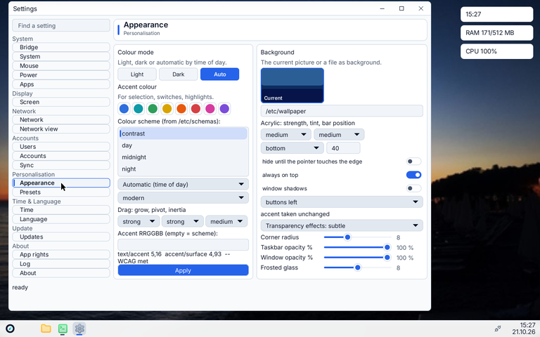
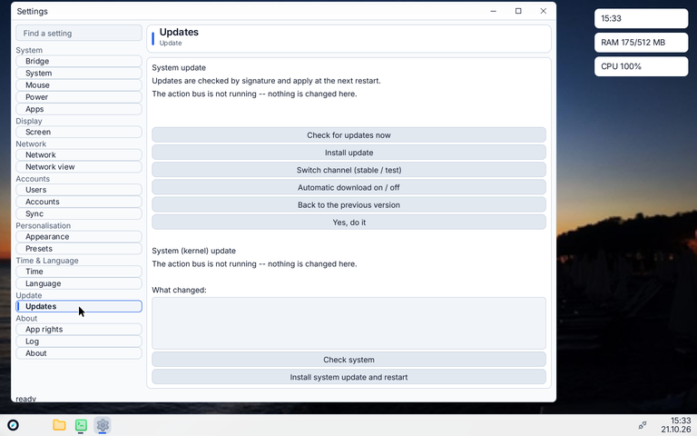
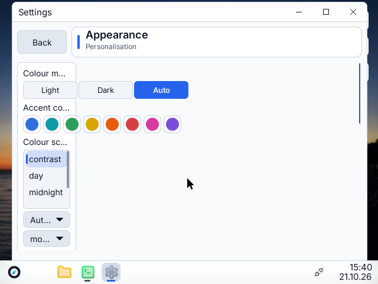

# Settings redesign — analysis and plan (SET)

Status: PLAN ONLY (21.10.2026). No redesign code is written yet. Rule of the boss: **plan first, then build.**
Language rule (boss, 21.10.2026): this document may be German or English; **code is English only** — identifiers, comments, log texts, file names, commit messages. UI strings go through the i18n catalogue (`locale/en`, `locale/de`). This plan therefore uses English page ids, row ids and catalogue keys everywhere (see section 8).

Problem (boss): *"Settings is confusing: too many buttons at once."*

Scope: `kernel/user/settings.fi` (11 472 lines on main `74483629`, was ~7 967 when the task was written), `kernel/user/settings.d/*`, `lib/settingsman/manifest.fi`, `docs/SETTINGS-MANIFEST.md`, gates `tools/settingsui|settingsnarrow|settingsfit|settingsman|settingsbook`, `tools/textfit`.
New helper scripts (analysis only): `tools/settingsaudit/{count.py,runtime.py,run.sh,ppm2png.py}`.

## 1. Summary (read this first)

* Settings has **19 pages** in a flat sidebar (8 labelled categories + "Apps" for package pages). Every page is **one or two cards with all controls visible at once** — no groups, no collapsed "Advanced", no descriptions per row.
* Measured at runtime (scene tree rects after each page build, 1280x800, scale 1): **Appearance 34 controls on one page, Presets 18, Screen 15, Accounts 12, Updates 9, Users 9, Power 8** (19 pages, 143 controls in total, 0 overlaps, 0 crashes). Appearance is over 20; Presets and Screen are over 12; Updates (9 buttons + list), Users, Power and App info follow.
* The "button wall" has three causes: (1) every page has its own **Apply** button and its own button set (two-step model); (2) **choices are shown as rows of buttons/dropdowns** where a toggle or one dropdown would do; (3) **rare/expert controls sit next to everyday ones** (custom resolution, gamma, system schema, five update buttons).
* A **manifest-based registry already exists** (r136/r143/r149: `settings.d/*.settings`, `lib/settingsman`, package pages `/apps/<app>.prog/SETTINGS`) but only the *Accounts* page uses it and the format has no groups, descriptions, icons, advanced sections, ordering or per-row search. The plan **extends this**, it does not start over.
* Target: **10 sidebar entries**, each a *landing page of grouped cards* (<= 7 rows per group, <= ~20 visible controls per page), details in **sub-pages with breadcrumbs**, expert controls in **collapsed "Advanced"**, **instant apply** by default, **search across rows** (not only pages), pages as **registry plugins**.
* Gates make it stick: controls-per-page limit, no overlap, screenshot diff, i18n/English-id lint (section 11).

## 2. Current inventory

### 2.1 Method

* **Static:** `python3 -I tools/settingsaudit/count.py [--md]` counts `fuiscene.*` widget constructors reachable from each `page_*` function (callees in the same file followed). Loops (energy columns, app list rows, colour swatches, permission toggles) are counted once, so the static number is a **lower bound**.
* **Runtime:** `bash tools/settingsaudit/run.sh <dir> halt=900` (via `/root/jarvis/bin/heavy`) boots the design-audit machine (`tools/design/audit.sh`, QEMU KVM, `uitrace=yes`), opens Settings, clicks all 19 sidebar tiles, takes a picture each, and `tools/settingsaudit/runtime.py` counts the `settings: rect name=wXX` scene-control lines after every page build (rects right of the sidebar). This is the scene-tree truth the gate will use. (The existing `tools/settingsui/run.sh` only visits 15 of the 19 pages: `a..o`; the new script visits `a..s`.)
* **Screenshots:** `docs/img/settings/` — `page-00-appearance.png` .. `page-18-apps.png` (one per sidebar page, sidebar order), `00-start.png`, `search-empty.png`; 1280x800 guest screen scaled to 60 %, light mode, scale 1, dev image `tools/design/audit.sh`. Raw numbers: `docs/img/settings/inventory-static.txt` and `inventory-runtime.txt`. Narrow window (640x480, navigation mode) and scale-2 captures come from the existing `tools/settingsnarrow/run.sh` (run on this build: `settingsnarrow nav1` (640x480): see finding below).

### 2.2 Controls per page

| Page id | Category today | Controls (static) | Runtime rects (QEMU) | buttons | toggles | dropdowns | entries | sliders | lists | text labels | > 12? |
|---|---|---|---|---|---|---|---|---|---|---|---|
| appearance | Personalisation | **22** | 34 | 1 | 3 | 10 | 3 | 4 | 1 | 12 | **YES** |
| screen | Display | **15** | 15 | 5 | 0 | 6 | 3 | 0 | 1 | 13 | **YES** |
| time | Time & Language | **3** | 3 | 1 | 0 | 2 | 0 | 0 | 0 | 4 |  |
| network | Network | **6** | 8 | 2 | 0 | 1 | 3 | 0 | 0 | 15 |  |
| users | Accounts | **9** | 9 | 4 | 0 | 1 | 4 | 0 | 0 | 6 |  |
| netview | Network | **5** | 5 | 2 | 0 | 2 | 0 | 0 | 1 | 6 |  |
| language | Time & Language | **3** | 3 | 1 | 0 | 2 | 0 | 0 | 0 | 4 |  |
| presets | Personalisation | **8** | 18 | 6 | 0 | 0 | 2 | 0 | 0 | 6 | **YES** |
| accounts | Accounts | **4** | 12 | 1 | 0 | 1 | 1 | 0 | 1 | 6 |  |
| sync | Accounts | **1** | 0 | 0 | 0 | 0 | 0 | 0 | 1 | 16 |  |
| bridge | System | **1** | 1 | 1 | 0 | 0 | 0 | 0 | 0 | 7 |  |
| system | System | **4** | 5 | 3 | 0 | 0 | 1 | 0 | 0 | 4 |  |
| approights | About | **3** | 5 | 3 | 0 | 0 | 0 | 0 | 0 | 4 |  |
| log | About | **1** | 2 | 1 | 0 | 0 | 0 | 0 | 0 | 3 |  |
| updates | Update | **9** | 9 | 8 | 0 | 0 | 0 | 0 | 1 | 10 |  |
| mouse | System | **5** | 5 | 0 | 3 | 0 | 0 | 2 | 0 | 3 |  |
| power | System | **4** | 8 | 0 | 0 | 2 | 0 | 2 | 0 | 7 |  |
| about | About | **1** | 1 | 1 | 0 | 0 | 0 | 0 | 0 | 3 |  |
| apps | System | **10** | 0 | 8 | 2 | 0 | 0 | 0 | 0 | 13 |  |
| **total** | | **114** | **143** | | | | | | | | **3 pages** |

Runtime caveat: the QEMU audit image has no battery, no network, no display mode list, no installed apps with rights, no cloud account. Pages that fill lists from live data show 0-2 rows there (Sync 0, Apps 0, Network tables empty); real hardware has MORE controls (energy page doubles per battery state, App info adds 8 buttons + toggles per app, mode list adds one row per resolution).

Reading the table: *Controls* = buttons + toggles + dropdown choices + entries + sliders + lists (labels excluded). "Runtime rects" counts every scene control incl. list rows and colour swatches.

### 2.3 What the pictures show (screenshots, 1280x800)

Concrete defects visible in `docs/img/settings/` (each becomes an acceptance check of its migration step):

* **Appearance** (`page-00-appearance.png`, 34 controls): the colour mode exists **twice** (segmented Light/Dark/Auto on top and a dropdown "Automatic (time of day)" under the scheme list); three dropdowns carry **no label** (`Automatic (time of day)`, `modern`, `buttons left`); five more are labelled only by a group heading ("Acrylic: strength, tint, bar position", "Drag: grow, pivot, inertia") so one cannot tell which dropdown is which; an orphan line "accent taken unchanged" sits above an unrelated dropdown; the contrast report is a free text line; **Apply** sits at the bottom of the left card while three toggles and four sliders on the right write immediately.
* **Screen** (`page-01-screen.png`): the resolution list is empty without a card but keeps a big box; **"Back"** (revert) collides with the navigation Back button; "Keep (also after restart)" and "Apply" are on a different card than the settings they affect; a custom-resolution form (3 entries, 2 buttons) is always open.
* **Users** (`page-04-users.png`): password, PIN and auto-lock in one card; 4 password/PIN entries, 4 buttons; the lock timeout has its own **Apply lock** although it is a plain choice.
* **Presets** (`page-07-presets.png`): 8 buttons in 2 columns (Apply, Save as mine, Export, Import, Link to account, Get from account); preset names are German catalogue leftovers (`Abendrot`, `Hoher Kontrast`) in an English UI.
* **Network** (`page-03-network.png`): 10 lines of read-only status as plain text, then a dropdown and three entries; **Apply** and **"Yes, change it"** sit in the *other* card (right) under the usage table; no DHCP toggle.
* **Updates** (`page-14-updates.png`): **6 equal buttons stacked** incl. **"Yes, do it"** (a confirmation button visible all the time, without a question) and a second block "System (kernel) update" with two more buttons; "ready" status overlaps the card bottom.
* **Power** (`page-16-power.png`): two blocks (battery/mains) with the same 4 rows each, unit text in labels ("(min)") — a good candidate for a table-like two-column group or a segmented "On battery / On mains".
* **Apps** (`page-18-apps.png`): "Usage and rights per app. There is no per-app power meter: 'battery' here is the share of CPU time among ..." — a **truncated explanatory paragraph** instead of a row description.
* **Narrow window (640x480, navigation mode)** (`narrow-03-page.png`): the Appearance page card is only ~100 px wide, labels are cut ("Colour m...", "Aut...", "mo...") and the rest of the page is empty — a layout defect of the two-column/navigation code that a single-column registry renderer removes by construction.
* **Sidebar:** category labels + 19 tiles; the first tile under "System" is **Bridge** (remote control), "System" is a schema editor, **App rights and Log are under "About"**, tiles are 23-25 px high bordered pills at 1280x800 (`item_h` shrinks to fit).

### 2.4 Patterns that create the wall (from the source)

| Pattern | Where | Effect |
|---|---|---|
| One **Apply** button per page (`K_B1`, `K_B2`, `K_B4`, `K_B6`, `K_B7`, lock `K_BSP`) next to live-writing sliders/toggles (sliders and toggles on the same page write at once, dropdowns need Apply) | Appearance, Screen, Network, Network view, Users | user cannot tell which change is already active |
| **Button rows** instead of one primary action | Updates: 6 buttons (Check / Install / Channel / Auto / Rollback / Confirm) + 2 more for system update; App info: 8 buttons | everything looks equally important |
| **Several dropdowns for one concept** | Screen: scaling, rotation, brightness, contrast, gamma, saturation, 3 custom-mode entries + 2 buttons; Appearance: 3 stepped drag choices, 2 blur choices | expert tuning next to "set resolution" |
| **No grouping**: label rows, thin spacing | Appearance right column: ~17 controls in one card | no scan path |
| **Two columns with unrelated content** (`two_cols`) | most pages | left/right order unclear, narrow windows reflow arbitrarily |
| **Page-wide state that is not a setting**: scheme list (table), user list, app list | Appearance, Users, Apps | lists look like forms |
| **Placeholder text rows** (honest limits, notes) as 2-3 line labels | Screen, Time, Display | text wall around the controls |
| **Mixed / German identifiers and keys** (`R_DARST`, `K_B1`, `settings.zieh.head`, `settings.blur.staerke`, `settings.kw12`) | whole file | hard to extend; violates the English-code rule |

## 3. Information architecture today

* Sidebar: **search field** (page level only: name, category, `settings.kwNN` keywords) + **19 tiles**, grouped under 8 muted category labels (`settings.cats`) plus "Apps" for up to 8 package pages (`PKG_MAX`). Entries shrink (`item_h` 32 -> 25 -> 23) to fit short windows because the sidebar does not scroll.
* Depth: **1** (sidebar -> page). No sub-pages, no breadcrumbs. Navigation mode (window < ~640 wide): list -> page with a Back button (`nav_mode()`), page scrolls (`page_scrolls()`).
* Header: one canvas (`hdr_cb`) with page title; status line at the bottom.
* Page body: `two_cols(reiter)` -> two cards side by side (left 45 % / right 55 %), single column in navigation mode.

| Category (today) | Pages (controls = static, runtime in 2.2) |
|---|---|
| System | System (schema editor), Bridge, Mouse, Power, Apps |
| Display | Screen |
| Network | Network, Network view (access/fallback rules) |
| Accounts | Users, Accounts, Sync |
| Personalisation | Appearance, Presets |
| Time & Language | Time, Language |
| Update | Updates |
| About | App rights, Log, About (by `cat_of` fallthrough: category 7) |
| Apps (package pages) | up to 8 from `/apps/<app>.prog/SETTINGS` |

Problems in the IA itself: "System" is a drawer (editor, remote bridge, mouse, power, apps); **App rights and Log live under "About"**; Presets (themes) sit apart from Appearance although both change the look; Bridge is a security feature filed under System; the 19 flat tiles exceed the usual 7-12.

## 4. Comparison (what the mainstream desktops do)

From general knowledge of the shipping products (not measured here); the points are the design takeaways.

| | Windows 11 Settings | GNOME Settings | KDE System Settings | macOS Ventura+ |
|---|---|---|---|---|
| Sidebar | **11 categories**, flat, icons | ~25 panels, flat list, icons, search at top | **~5 groups -> ~40 modules**, tree sidebar (also "Icons" or "Tree" view) | ~30 entries in 4 blocks, icons, search |
| Page | **cards**: icon + title + 1 line description + control on the right (toggle/dropdown/chevron) | **boxed lists** (`AdwPreferencesGroup`): rows with title/subtitle and switch/dropdown/arrow | grouped forms; **Apply/Reset bar** (+ "highlight changed settings") | grouped form sections, toggles, **"(i)" and "Advanced..." sheets** |
| Detail | chevron row -> **sub-page**, **breadcrumb** header ("System > Display > Advanced display") | row with arrow -> **sub-page** (navigation, back arrow), dialogs for rare tasks | sub-categories in the tree, "Configure..." dialogs | "Advanced..." / "Options..." sheets |
| Toggles vs buttons | toggles + dropdowns; buttons only for actions | switches + dropdown rows; buttons for actions | checkboxes/combos; Apply batches | switches/popups; buttons for actions |
| Search | top bar, **finds individual settings** (results list with breadcrumb) | sidebar search, finds panels | **finds modules and settings**, highlights | finds individual settings |
| Advanced | expanders ("Additional settings", "Advanced") collapsed | "Advanced" subpages; rare settings left to dconf | "Advanced" tabs/sections | "Advanced..." button |
| Typical size | 5-12 rows per card, 1-3 cards per page | 3-12 rows per group | 5-15 controls per module | 5-12 rows per section |

Takeaways we adopt: **~10 flat categories**, **one row = one setting**, **toggle for yes/no, dropdown for choice, button only for an action**, **drill-down sub-pages with breadcrumb**, **collapsed Advanced**, **search finds settings**, **instant apply** (Windows/GNOME/macOS) with a **Keep/Revert dialog only for risky changes** (resolution). We do NOT copy KDE's Apply bar (batching makes the "what is active" question worse) or its tree sidebar.

## 5. Target information architecture

Sidebar (10 entries, flat, icons, no category labels; the current 8 labels become the page titles):

| # | Entry | Landing page groups (cards) | Sub-pages | Replaces today |
|---|---|---|---|---|
| 1 | **Personalization** | Look (mode, accent, scheme, wallpaper) · Taskbar (position, size, auto-hide, calendar) · Themes (apply, save) | Window effects (advanced), Taskbar, Themes | Appearance, Presets |
| 2 | **Display** | Display (resolution, scaling, brightness) | Advanced display (rotation, contrast, gamma, saturation, custom mode, colour depth) | Screen |
| 3 | **Network** | Connection (status, automatic/manual toggle) · Address (IP/mask/gateway when manual) | Connections & usage | Network, Network view (access/fallback rules) |
| 4 | **Input devices** | Mouse (speed, scroll direction) · Touchpad/gestures | Pointer acceleration, Gestures | Mouse |
| 5 | **Accounts** | Your account · Sign-in options (password, PIN, auto-lock) · Cloud accounts | Change password, PIN, Cloud account details, Sync | Users, Accounts, Sync |
| 6 | **Time & language** | Date & time · Language & keyboard | Time zone | Time, Language |
| 7 | **Apps** | Installed apps (list) | App info (permissions, storage/network/battery, stop, uninstall) | Apps |
| 8 | **Privacy & security** | App permissions summary · Remote control (bridge) · Activity log | App permissions, Remote control, Activity log | App rights, Bridge, Log |
| 9 | **Updates** | Status + ONE primary button · Options (channel, automatic) | Update history, Advanced (rollback, confirm, system update) | Updates |
| 10 | **System** | Power & battery · About (name, version, report) | Power & battery, About, Advanced (system schema editor) | Power, About, System |

Package pages (`/apps/<app>.prog/SETTINGS`) join the sidebar entry named in their `group` field (new `group` values map to these ids); unknown groups go under **Apps**. Future: **Sound** (r640) and **Bluetooth** (r6) enter as rows/sub-pages of *Input devices*/*System* until they justify their own entry.

Depth: sidebar entry -> landing page -> sub-page (**max 2 levels below the sidebar**, breadcrumb shows both). Today every setting is 1 click away but hidden among 20-34 controls; after: every everyday setting is visible on the landing page, every expert setting is <= 2 clicks.

## 6. Layout rules (the contract for every page)

1. **Row = one setting.** Layout `[icon] title + optional one-line description | control`. One control per row, control on the right. No bare labels between controls (use group titles).
2. **Group (card) <= 7 primary rows.** More rows -> split into groups or move the tail to *Advanced*. Page <= 5 groups, <= ~20 visible controls (hard gate limit 24, see 11).
3. **Control choice:** yes/no -> **toggle**; 2-4 short exclusive options -> **segmented control**; 3+ options -> **dropdown**; continuous -> **slider with value readout**; free text/number -> **entry with validation text**; **button = action only** (verb label: "Check for updates", never "Apply"). Never two buttons for one yes/no.
4. **One primary (accent) button per page**, secondary buttons are quiet; destructive actions ("Uninstall", "Reset", "Revoke") sit in their own group at the bottom, never next to the primary action, always confirmed.
5. **Instant apply.** Toggles/choices/sliders write through the bus at once and the status line says "Saved". Exceptions need a *batch form* (password, IP address) -> one **Apply** inside that group only, or a **Keep/Revert dialog** for risky changes (resolution: existing countdown). A page never has a global Apply.
6. **Progressive disclosure.** Rare/expert controls go into a **collapsed "Advanced" group** (state remembered per page) or a sub-page. Defaults: everything an average user changes weekly is on the landing page; everything else is one click deeper.
7. **Labels.** Sentence case, <= 38 characters (matches the existing `settingsfit` limit), noun phrases for settings, verbs for buttons, no trailing colon, no abbreviations; description <= 2 lines, muted; honest-limit notes become row descriptions or an info row, never a free paragraph.
8. **Icons.** 20 px symbol per sidebar entry and per sub-page row (manifest field `symbol` already exists; SVG source depends on D-017 / r74 — fallback: coloured letter tile).
9. **Spacing.** Rows 44-48 px (compact mode 36), card padding and gaps from design tokens (`docs/DESIGN-TOKENS.md`, `wlibc.space()`), **no pixel literals in pages**; one column with a reading width of ~640-720 px, **no left/right split** (wide windows get margins, narrow windows are identical -> navigation mode needs no special layout).
10. **Keyboard / focus.** Tab order = visual order, **one tab stop per row**, Up/Down moves between rows of a card, Space/Enter toggles/activates, Left/Right changes a segmented control, Esc / Alt+Left / Backspace = back one level, Ctrl+F = search, type-ahead in the sidebar; visible focus ring (accent, 2 px, contrast >= 3:1); every control reachable and operable without a pointer; every control has an accessible name (a11y tree, `docs/A11Y.md`).
11. **Breadcrumb header** `Personalization > Taskbar` (clickable), replaces the title canvas.
12. **Every page degrades to navigation mode** (< ~640 px) without separate code.

## 7. Registry-based design (settings pages as plugins, like `ctxreg`)

`kernel/user/ctxreg.fi` shows the pattern: *owner asks the registry, the registry returns rows; extensions come from a manifest file; the owner decides what an action does.* The Settings registry (`settingsreg`) does the same for pages.

### 7.1 What already exists (keep)

`lib/settingsman/manifest.fi` (no heap, static tables), `kernel/user/settings.d/accounts.settings` embedded with `__include_str`, package pages from `/apps/<app>.prog/SETTINGS` (`add_pkg`, rights check, `app` = package folder), bus-backed `read`/`write` actions per field (broker handles rights, confirmation, audit), golden tests `tools/settingsman` (66 checks, 43 parser mutations). Limits today: 8 pages and 80 entries per file, 24 pages / 240 entries / 8192 B text per catalogue; `choice`/`list` are not drawn from the manifest.

### 7.2 Format v2 (additions, all English ids)

```
manifest 2
app settings
page appearance settings.page.appearance.title symbol-palette personalization     # id, title key, symbol, category id
order 10
keywords settings.page.appearance.keywords          # extra search words (catalogue key)
parent -                                            # or a page id => sub-page, breadcrumb
need-flag battery                                   # hide page when the device lacks the feature
group look settings.group.look.title                # a card; "group x key advanced" = collapsed by default
field mode choice settings.row.appearance.mode.label
  desc settings.row.appearance.mode.desc            # one-line description
  options settings.row.appearance.mode.options      # catalogue key with "\n"-separated items (enables choice/segmented)
  style segmented                                   # segmented|dropdown|toggle|slider|entry|button|link|status
  symbol symbol-sun
  read settings.theme.get
  write settings.theme.set
  search settings.row.appearance.mode.kw            # per-row search words
  risk confirm                                      # none|confirm|keep-revert (bus risk classes)
link advanced-display settings.row.display.advanced.label     # chevron row -> sub-page
```

* New verbs: `order`, `keywords`, `parent`, `need-flag`, `group [advanced]`, `desc`, `options`, `style`, `symbol` (per field), `search`, `risk`, `link`, `slider min max step unit`.
* Old rules stay: unknown verbs are skipped and counted, known verbs with wrong words reject the whole file, names `[a-z0-9._-]`, keys are catalogue keys only (no sentence in a manifest).
* Limits raised for the built-in set: 48 pages, 64 groups, 640 entries, 24 KiB text (static tables, no heap); package limits stay small (<= 3 KiB per package).
* Lint (in `tools/settingsman/run.sh`, part of the gate): group <= 7 primary rows, <= 1 primary button per page, every key in `en` **and** `de`, ids English, description <= 80 chars, no `Apply` label.

### 7.3 Providers

| Kind | What | Example |
|---|---|---|
| **Manifest page** | declarative; generic row renderer draws it from the catalogue (`group` -> card, `field` -> row by `style`) | Network, Time, Language, Updates, Mouse, About, most others |
| **Code page** | `settingsreg.add_page(id, title_key, symbol, category, order, build_cb)`; `build_cb(card_parent)` builds custom widgets (colour swatches, resolution preview, app list); it still ships an **index-only manifest** (`page ... / group ... / field ...` lines flagged `index`) so search finds its rows | Appearance preview, Display arrangement, App list |
| **Package page** | `/apps/<app>.prog/SETTINGS` (exists) | any app |
| **Drop-in** | `/etc/settings.d/*.settings` (like `/etc/ctxmenu.conf`) for admins/tests | local pages |

All providers register into one table; the sidebar, breadcrumb, landing page and search read only that table. A shared row library (`lib/fui/rows.fi`: `row_toggle/row_choice/row_slider/row_entry/row_button/row_link/row_status`) is used by the generic renderer **and** by code pages so every row looks the same.

### 7.4 Search index

* Built at start (and when a package page appears) from catalogue keys: page title, group title, row label, row description, `keywords`/`search` keys, in the **current language** (`msg.get`).
* `settingsreg.search(query) -> hits[]` (page, group, row, rank): all words must match (prefix, case-insensitive; same word logic as today's `page_matches`), rank: page title > group > row label > keywords. Max ~400 indexed rows (static array).
* UI: results list under the search field ("Brightness - Display > Brightness"); picking a result opens the page, scrolls to the row and highlights it ~1.5 s. "No results" row stays (`settings.nohit`).
* Replaces numbered `settings.kwNN` keys by `settings.page.<id>.keywords`.

### 7.5 Constraints to respect

* Firn has **no re-export** (r1337): the registry exports a flat API; split `settings.fi` by page with the skill `firn-module-split-wlib` (const aliases + forwarding functions).
* Static tables only in `manifest.fi`; `MAXWN` (window slots, now 9) matters for dropdown popups — one popup open at a time.
* Writes go **only** through the bus (`settings.<area>.write`, rights, risk confirm, audit — AB-005); pages never write config files directly (the last direct writers: Appearance theme.conf, Network, Display).

## 8. English-only identifiers (boss correction 21.10.2026)

* Page ids: `appearance display network input accounts time-language apps privacy updates system` and sub-pages like `taskbar`, `window-effects`, `advanced-display`, `change-password`. No `darst/vorl/bruecke/rechte/proto/benut/netv`.
* Catalogue keys: `settings.page.<id>.title|keywords`, `settings.group.<id>.title`, `settings.row.<page>.<row>.label|desc|options|kw`; remove numbered `settings.kwNN`, `settings.zieh.*`, `settings.blur.staerke|tonung`, `*.nocard` style leftovers when a page migrates (old keys stay until the last user is gone — the i18n gate checks both languages).
* Source constants: `PAGE_APPEARANCE`, `K_*` renamed per page when it migrates; German comments in a migrated page are translated in the same commit. UI texts stay de/en via the catalogue (a German UI is fine, German code is not).
* Lint: extend the existing English-code guard (`docs/ENGLISH-AUDIT.md`) with a settings rule: no identifier/key in `settings.d/*.settings` and `kernel/user/settings*.fi` from the German word list.

## 9. Migration plan (page by page)

Order = biggest pain first, each step is one branch with before/after screenshots and gate numbers; old pages keep working until their replacement is merged (`R_*` tiles stay in the table until then).

| Step | Work | Controls today -> target (landing, visible) |
|---|---|---|
| SET-1 | **Gates first**: `tools/settingsaudit` (static + runtime count, overlap, screenshot baseline) wired into `gates.tsv` as nightly; baseline numbers from this document | - |
| SET-2 | **Registry core**: manifest v2 parser + lint + raised limits, `settingsreg` table, shared row library, generic renderer, golden tests (both readers: Firn + Python) | - |
| SET-3 | **Shell**: 10-entry sidebar with icons, landing page + sub-page navigation, breadcrumb header, single column, instant-apply plumbing ("Saved" status), Advanced expander | - |
| SET-4 | **Search across rows** (index + results list + highlight) | page-level -> row-level |
| SET-5 | **Updates** (9 buttons) -> status + 1 primary + Options + Advanced; merge OTA and system update | 9 -> 5 |
| SET-6 | **Personalization** (Appearance + Presets): mode segmented, accent swatches, scheme dropdown, wallpaper; Taskbar and Window effects as sub-pages | 22-34 -> 8 |
| SET-7 | **Display**: resolution, scaling, brightness on the landing page; rotation/contrast/gamma/saturation/custom mode in Advanced display; Keep/Revert dialog | 15 -> 5 |
| SET-8 | **Accounts**: Users + Accounts + Sync into one entry; password/PIN as sub-pages with their own Apply | 13+5+1 -> 7 |
| SET-9 | **Apps + Privacy & security** (App info as sub-page, destructive group at the bottom; App rights, Bridge, Log) | 10 -> 6 |
| SET-10 | **Network** (automatic toggle hides manual fields; Connections as sub-page) | 6+5 -> 5 |
| SET-11 | Small pages: Time & language, Input devices, System (Power, About, Advanced) as manifest pages | each <= 8 |
| SET-12 | Icons (SVG, D-017), a11y names, keyboard map, focus-ring check | - |
| SET-13 | Remove old `page_*` code and German identifiers; delete dead keys; update docs (`SETTINGS-MANIFEST.md`, `ACTION-BUS.md`) | `settings.fi` shrinks |

Rollback: each step keeps the previous page selectable via the `R_*` table until the next step is merged; the registry steps (SET-2/3) are additive.

## 10. Risks and open decisions

* **Product decisions (for the boss):** (a) accept instant apply (no Apply) as default; (b) merge Bridge/App rights/Log under "Privacy & security"; (c) one column only (no two-column pages). Recommended: yes to all three.
* Setting changes that are *not* instantly reversible (IP address, password, resolution) need their own batch form or Keep/Revert dialog — design in SET-3.
* `settings.fi` is 11.5k lines: migrating while others add pages (App info, Info page, mouse, power) causes merge conflicts -> do SET-3 first and freeze new pages in the old style (new pages as manifests only).
* Dropdown popups use window slots (`MAXWN` 9): check with `wlib` slot gate after SET-3.
* Screenshots here are the dev image (light mode, scale 1); dark mode and scale 2 need the same run (`mode=dark`, `uiscale=2`) for the baseline.

## 11. Gates

| Gate | What it checks | How |
|---|---|---|
| **Control budget** (static) | per page: groups <= 7 rows, visible controls <= 20 (hard 24), advanced groups collapsed; no page with a global Apply; `tools/settingsaudit/count.py --limit` -> exit code | host, <1 s |
| **Control budget** (runtime) | the same on the scene tree: `tools/settingsaudit/runtime.py serial.txt --limit` after `tools/settingsaudit/run.sh` (all pages, both languages) | QEMU, ~10 min, nightly |
| **No overlap / clipping** | rect overlaps = 0 (already in `runtime.py`), no rect past the window edge, `tools/textfit` (no shortened chrome text), existing `settingsnarrow` (640x480 nav1, 1280x800 scale 2 nav2, 800x480 low) | QEMU |
| **Screenshot diff** | per page picture vs baseline in `docs/img/settings/` (dev image, fixed clock hidden), tolerance in % of pixels, diff images on failure; baseline updated only by an explicit commit | host, uses PPM from the run |
| **Search** | each page title and ~20 sample row labels are found; "zzzz" gives the no-hit row; result opens the right page and highlights the row | QEMU (extends `settingsui`) |
| **i18n + English ids** | every key in `en` and `de`; ids `[a-z0-9._-]`, from the English word list; max label length 38 (extends `settingsfit`) | host |
| **Keyboard** | Tab through every control (focus order = rect order), Esc/Alt+Left go back, Space toggles; existing `07-focus` shot of `settingsnarrow` generalised | QEMU |
| **Registry** | `tools/settingsman/run.sh` with v2 golden cases, catalogue limits, 43+ parser mutations | host |

## 12. Roadmap items

Added to the JARVIS project roadmap (group `Settings`, IDs `SET-n` in the text): SET-1 .. SET-13 as in section 9.

## 13. Screenshots

Files in `docs/img/settings/`:

* `00-start.png`
* `narrow-00-start.png`
* `narrow-03-page.png`
* `narrow-05-page-wheel2.png`
* `narrow-07-focus.png`
* `page-00-appearance.png`
* `page-01-screen.png`
* `page-02-time.png`
* `page-03-network.png`
* `page-04-users.png`
* `page-05-netview.png`
* `page-06-language.png`
* `page-07-presets.png`
* `page-08-accounts.png`
* `page-09-sync.png`
* `page-10-bridge.png`
* `page-11-system.png`
* `page-12-approights.png`
* `page-13-log.png`
* `page-14-updates.png`
* `page-15-mouse.png`
* `page-16-power.png`
* `page-17-about.png`
* `page-18-apps.png`
* `search-empty.png`

Examples:







